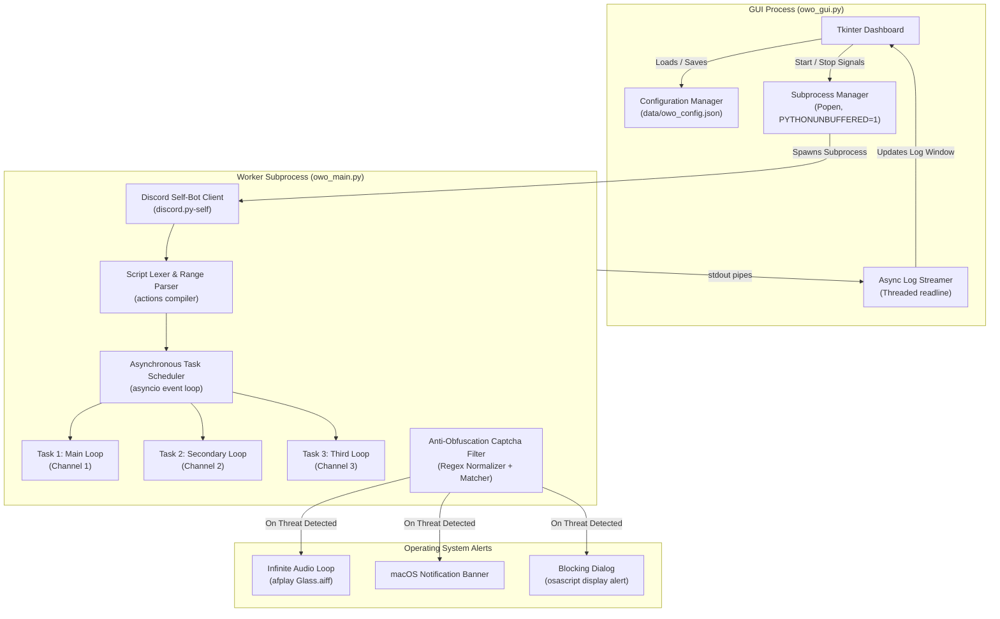
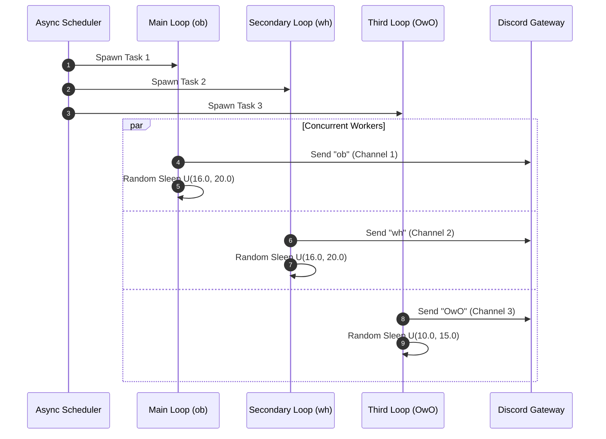
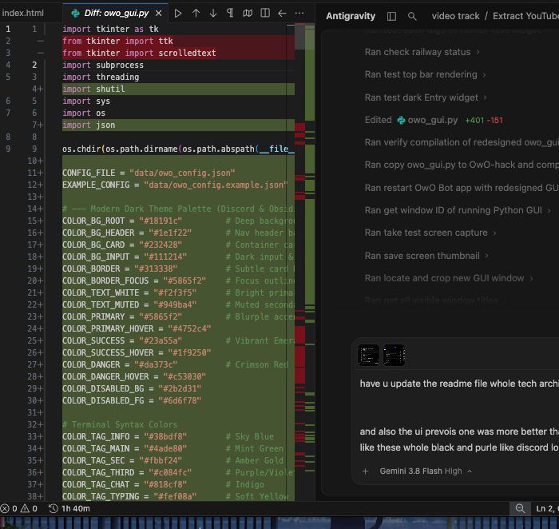
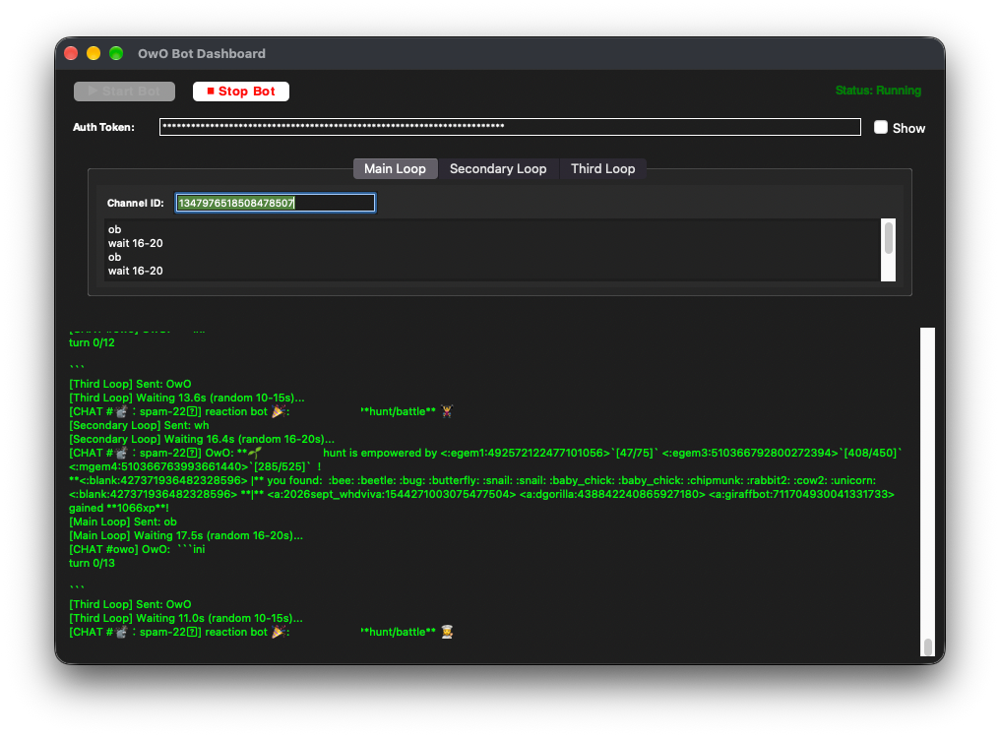
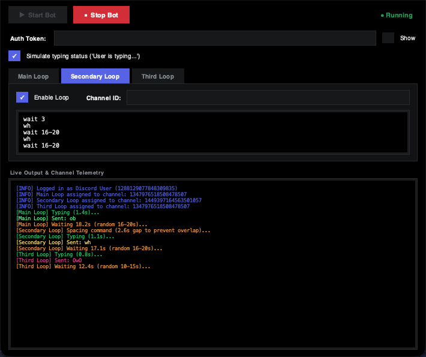
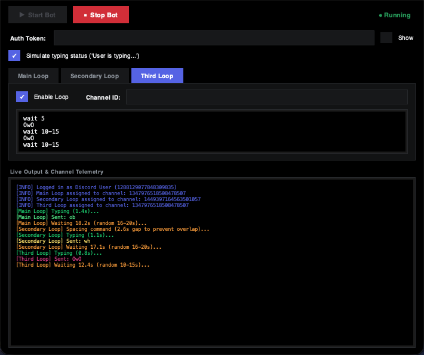

# OwO Automation Suite

A high-performance, asynchronous desktop automation suite and graphical dashboard designed for multi-channel command execution, dynamic interval jittering, and real-time obfuscation-resistant captcha protection.

---

## 1. Architectural Overview

The suite is engineered with a decoupled two-process architecture consisting of a desktop management supervisor (Tkinter GUI) and an asynchronous client worker (`discord.py-self` engine). The worker runs in a separate subprocess with unbuffered standard I/O pipes, ensuring that execution logs, channel responses, and anti-captcha triggers are streamed directly to the dashboard in real time without blocking the UI thread.



---

## 2. Core Technical Components

### 2.1 Multi-Task Asynchronous Event Loop
The backend runtime leverages Python's `asyncio` cooperative multitasking framework. Rather than sequential blocking loops, the client schedules up to three independent concurrent workers:
- **`spam_task_1` (Main Loop):** Dispatches commands mapped to `owo_channel`.
- **`spam_task_2` (Secondary Loop):** Dispatches commands mapped to `owo_channel_2`.
- **`spam_task_3` (Third Loop):** Dispatches commands mapped to `owo_channel_3`.

Each loop is individually toggleable through its dedicated **Enable Loop** checkbox inside each tab header. You can selectively run any single loop, any two loops, or all three loops concurrently. Unchecked loops remain dormant and do not consume resources or spawn background coroutines.

Each task operates independently on its own execution timeline. An interruption or delay in one channel does not alter the scheduling cadence of the other channels.



### 2.2 Dynamic Uniform Jitter Engine
To evade fixed-cadence behavioral heuristics, the engine implements a dynamic uniform range sampler.

When a range statement such as `wait 16-20` is parsed, the interval is compiled into a range tuple:

$$\Delta t \sim \mathcal{U}(a, b)$$

where $a = 16.0$ and $b = 20.0$. On every execution iteration, the engine dynamically samples:

$$\Delta t_{\text{sleep}} = \text{round}(\text{random.uniform}(a, b), 1)$$

Because each loop evaluates this function independently, the delays generated for different loops continuously drift relative to each other, preventing synchronized packet bursts.

### 2.3 Global Anti-Collision Lock and Command Spacing
Sending battle (`ob`) and hunt (`wh`) commands at the exact same second from the same account triggers rate-limit flags and represents an obvious robotic signature.

To prevent simultaneous transmissions across concurrent tasks, the engine enforces a centralized synchronization barrier via `asyncio.Lock`:
- Whenever any loop is ready to transmit a command, it requests exclusive acquisition of `self.send_lock`.
- It measures the elapsed time since the most recent command was transmitted by any loop:

  $$\Delta t_{\text{elapsed}} = t_{\text{now}} - t_{\text{last\_sent}}$$

- If $\Delta t_{\text{elapsed}}$ is less than a dynamically sampled anti-collision threshold:

  $$\Delta t_{\text{gap}} \sim \mathcal{U}(2.0, 4.0)$$

  the coroutine delays its transmission by the remaining difference:

  $$\Delta t_{\text{extra}} = \Delta t_{\text{gap}} - \Delta t_{\text{elapsed}}$$

- Only after this 2 to 4 second human gap has passed does it transmit the message, record the new timestamp, and release the lock.

This guarantees that battle and hunt commands never fire simultaneously or within 2 to 4 seconds of each other.

### 2.4 Human Typing Status Simulation
Real human users display an active "User is typing..." presence in Discord channels prior to dispatching messages. Instantaneous message bursts without a preceding typing trigger represent a primary heuristic used by anti-automation detectors.

When `simulate_typing` is enabled (default: `true`):
- Immediately prior to sending a command, the client initiates the official Discord typing lifecycle via `async with channel.typing():`.
- It sustains the animated typing status for a realistic duration:

  $$\Delta t_{\text{typing}} \sim \mathcal{U}(0.6, 1.4)$$

- Users and bot observers in the server observe the native "User is typing..." indicator before the message arrives.
- Can be enabled or disabled at any time via the dashboard checkbox.

### 2.5 Anti-Obfuscation Captcha Defense
Automated detection systems often disguise verification challenges using invisible zero-width unicode characters (e.g., `U+200B`, `U+200C`, `U+FEFF`), varied casing, and non-alphanumeric separators.

The verification interception pipeline processes incoming messages through an aggressive regex normalizer:
1. Strips all embed metadata, titles, and text strings into lowercase.
2. Applies character-class reduction: `re.sub(r'[^a-z]', '', content)` to purge all whitespace, punctuation, and hidden unicode codepoints.
3. Tests against signature strings including:
   - `areyouarealhuman`
   - `captcha`
   - `verifythatyouarehuman`
   - `linkbelowssoicancheck`
   - `resultinaban`

Upon match detection, the bot immediately halts all tasks, initializes a continuous audio alert thread (`afplay /System/Library/Sounds/Glass.aiff`), triggers an operating system notification, and displays a blocking modal dialog requiring manual intervention before process termination.

---

## 3. Graphical Interface & User Dashboard

The suite features a custom dark desktop dashboard engineered to avoid default OS Aqua rendering quirks and provide a unified Discord-inspired visual hierarchy.



### 3.1 Main Loop Configuration
Dedicated interface for primary battle and farming commands (`ob`).



### 3.2 Secondary Loop Configuration
Dedicated interface for secondary hunting commands (`wh`) mapped to an alternate channel.



### 3.3 Third Loop Configuration
Dedicated interface for auxiliary interval commands (`OwO`) mapped to a third target channel.



---

## 4. Script Syntax Specification

Scripts are composed of line-delimited commands executed sequentially in an infinite cycle.

| Syntax Pattern | Type | Example | Behavior |
| :--- | :--- | :--- | :--- |
| `<command>` | Message Command | `ob`, `wh`, `OwO` | Transmits literal text to the assigned channel ID. |
| `wait <number>` | Fixed Delay | `wait 16` | Suspends execution of the current loop for exactly $N$ seconds. |
| `wait <min>-<max>` | Dynamic Jitter | `wait 16-20` | Samples a random floating-point sleep from $\mathcal{U}(\text{min}, \text{max})$. |
| `# <text>` / `// <text>` | Comment | `# initial setup` | Ignored by the lexer. |

### Sample Scripts

**Main Loop (`ob`):**
```text
ob
wait 16-20
ob
wait 16-20
ob
wait 16-20
```

**Secondary Loop (`wh`):**
```text
wait 3
wh
wait 16-20
wh
wait 16-20
wh
wait 16-20
```

**Third Loop (`OwO`):**
```text
wait 5
OwO
wait 10-15
OwO
wait 10-15
OwO
wait 10-15
```

---

## 5. Installation and Setup

### 5.1 Prerequisites
- Python 3.10 or higher
- macOS (for native audio and notification features)

### 5.2 Clone Repository
```bash
git clone https://github.com/tejuas98/OwO-hack.git
cd OwO-hack
```

### 5.3 Install Dependencies
```bash
pip3 install -r requirements.txt
```

### 5.4 Configuration
Copy the sample configuration file:
```bash
cp data/owo_config.example.json data/owo_config.json
```

Edit `data/owo_config.json` with your Discord authorization token and target Channel IDs:
```json
{
   "user_token": "YOUR_DISCORD_AUTHORIZATION_TOKEN",
   "owo_channel": "TARGET_CHANNEL_ID_FOR_LOOP_1",
   "owo_channel_2": "TARGET_CHANNEL_ID_FOR_LOOP_2",
   "owo_channel_3": "TARGET_CHANNEL_ID_FOR_LOOP_3",
   "owo_script": "ob\nwait 16-20\nob\nwait 16-20",
   "owo_script_2": "wh\nwait 16-20\nwh\nwait 16-20",
   "owo_script_3": "OwO\nwait 10-15\nOwO\nwait 10-15"
}
```

*Note: You can also enter and modify these values directly inside the graphical interface; changes are automatically persisted to disk.*

### 5.5 Launching the Application
Execute the graphical dashboard:
```bash
python3 owo_gui.py
```
Click **Start Bot** to begin automated execution.

---

## 6. Security and Anti-Ban Guidelines

1. **Authorization Token Protection:** Never share, commit, or push `data/owo_config.json` containing live Discord tokens. The `.gitignore` file is pre-configured to exclude this file.
2. **Interval Pacing:** Do not reduce intervals below 15 seconds for battle/hunt commands to maintain compliance with server-side rate limits.
3. **Audible Alert Monitoring:** Ensure system volume is audible so you can complete manual verification prompts immediately if the alarm triggers.

